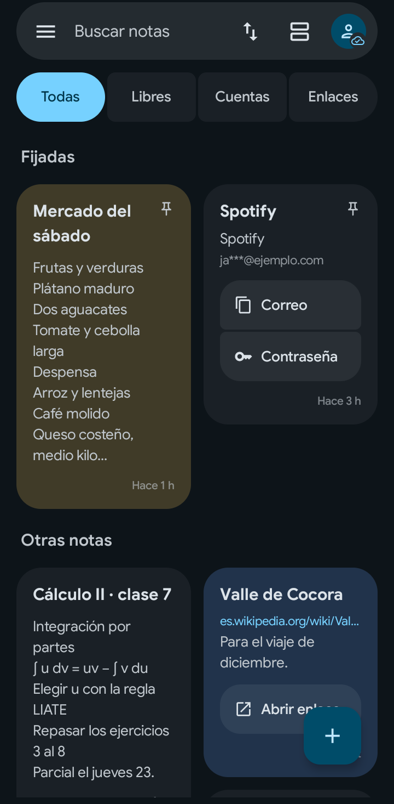
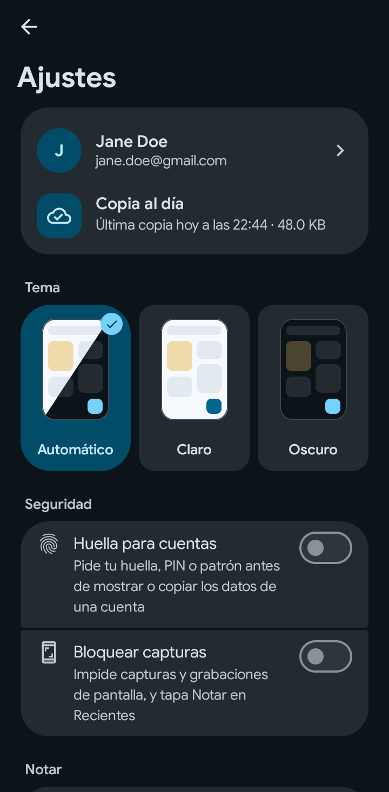
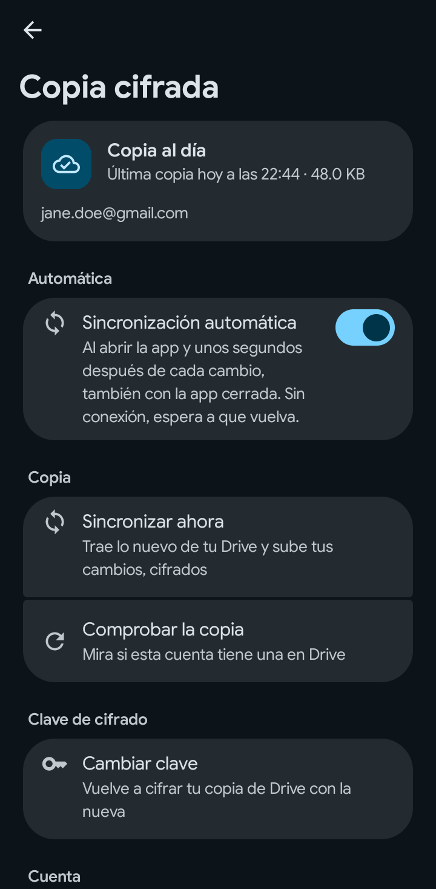

# Notar

Notas para Android que se guardan en tu teléfono y, si quieres, en tu Google Drive, cifradas con una clave que solo tú sabes. Hay tres tipos de nota: texto libre, cuentas con su contraseña y enlaces.

## Capturas de pantalla

  
  
  

| Inicio | Ajustes | Copia cifrada |
|:------:|:-------:|:-------------:|
| Fijadas arriba, filtros por tipo y vista en dos columnas | La cuenta y su copia arriba, tema y seguridad | Sincronización con Drive, cifrada con tu clave |

Las capturas usan datos de demostración.

## Qué hace

### Tres tipos de nota

- **Libres.** Texto con negrita, cursiva, subrayado, encabezados y listas con viñetas o numeradas.
- **Cuentas.** Servicio, correo, usuario y contraseña, cada dato con su botón de copiar. La contraseña se guarda cifrada en el teléfono.
- **Enlaces.** La dirección con un título y una descripción. Notar carga la vista previa de la página, con su imagen, el icono del sitio y el título, y la guarda para no pedirla otra vez.

### Organizar

- Fija, archiva o manda a la papelera cualquier nota. Ordénalas por fecha o a mano, arrastrando las tarjetas.
- Selecciona varias notas en Inicio, Archivo o Papelera para fijarlas, archivarlas, restaurarlas o borrarlas de una vez.
- Dale a cada nota un color, y elige entre una y dos columnas desde la barra de búsqueda.
- La búsqueda resalta la coincidencia en cada resultado. Dentro de la nota, puedes saltar de una coincidencia a la siguiente.

### Privacidad en el teléfono

- Ocultar una nota la difumina en Inicio hasta que la vuelvas a mostrar.
- Con «Huella para cuentas», ver o copiar una contraseña pide tu huella, PIN o patrón.
- «Bloquear capturas» impide capturas y grabaciones de pantalla, y tapa Notar en Recientes.

### Sincronización con Google Drive

- Tus notas se suben a tu Drive como un único archivo cifrado, en una carpeta de la app que no aparece entre tus archivos. Sin tu clave nadie puede abrirlo, tampoco Google.
- Si usas Notar en dos teléfonos, de cada nota se queda la versión más reciente.
- La sincronización automática trae lo nuevo al abrir la app y sube cada cambio unos segundos después, también con la app cerrada. Se puede apagar. El botón de cuenta de Inicio avisa cuando hay algo sin subir.
- Al cerrar sesión, las notas que ya están en Drive se quitan del teléfono y vuelven al entrar otra vez, como en Keep. Las que no se habían subido se quedan.

La interfaz usa Material 3 Expressive, toma los colores de tu fondo de pantalla (Material You) y tiene tema claro, oscuro o automático.

## Instalación

Descarga el APK de la última versión en [Releases](../../releases) e instálalo. Android puede pedirte permiso para instalar apps que no vienen de Play Store.

Necesita Android 8.0 (API 26) o superior.

## Tecnologías

- Kotlin y Jetpack Compose, con Material 3 Expressive
- Hilt para la inyección de dependencias
- Room y Jetpack DataStore para los datos locales
- WorkManager para sincronizar en segundo plano
- Credential Manager para iniciar sesión con Google
- API de Google Drive
- AndroidX Biometric

## Licencia

Copyright © 2026 dony-aep. Todos los derechos reservados. Los términos están en [LICENSE](LICENSE).
